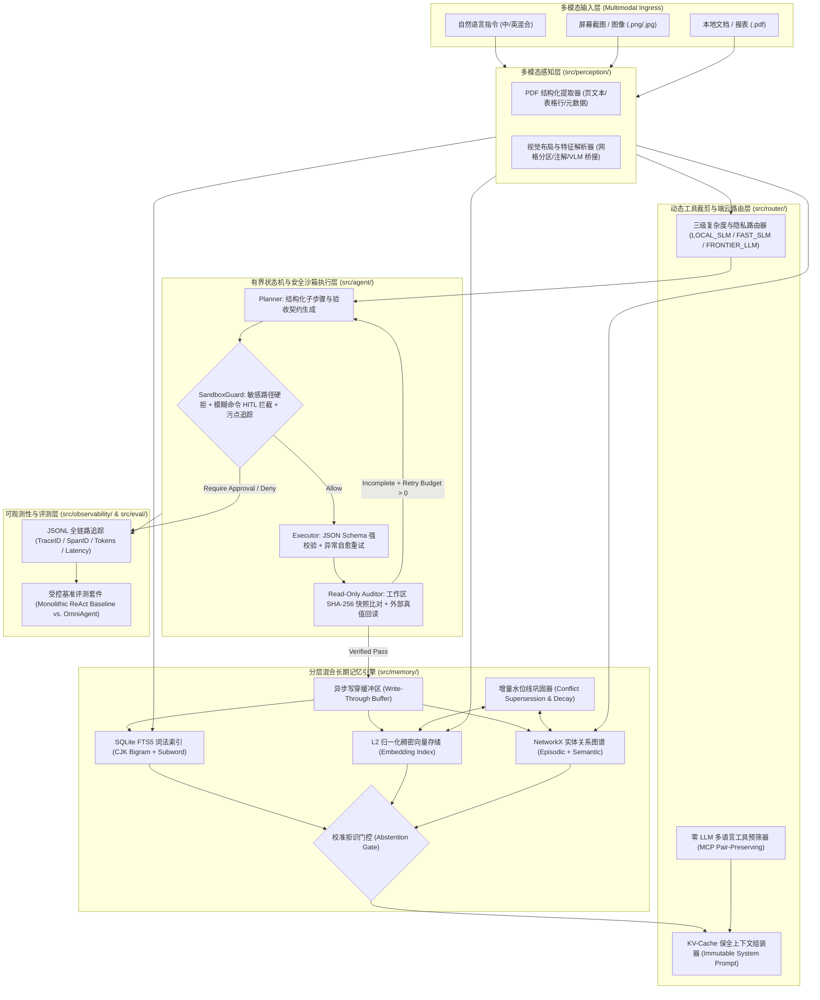

# Omni-Personal-Agent 系统架构与算法规范 (`ARCHITECTURE.md`)

## 1. 基座选型与架构融合决策

本系统以 **Sentient v3**（本地单文件混合记忆 + 端云多角色路由 + 零大模型工具预筛）为核心基座，融合 **AMAP-ML/LongHorizon-Harness**（三角色状态机 + 全新上下文执行 + 独立只读审计回滚）、**Inno Agent**（Adamic-Adar 拓扑图扩展 + 模糊命令降级审批）与 **Linger**（KV-Cache 保全的用户态上下文注入协议），构建面向单机与混合 API 环境的多模态个人智能体系统 `Omni-Personal-Agent`。

### 1.1 原生开源基座的已核验缺陷与本系统改进映射

| 基座来源 | 原仓库已核验物理瓶颈 | 本系统改进机制与代码落点 |
| :--- | :--- | :--- |
| `existence-master/Sentient` | `toolselect.py` 使用纯英文正则 `[a-z0-9]+`，中文指令词集退化为空集；`dreaming.py` 使用 $O(N^2)$ 全量矩阵内积做夜间去重 | `src/router/tool_selector.py`：CJK 双字组（Bigram）+ 拉丁词干 + 稠密向量 + MCP 发现/执行成对约束；`src/memory/consolidator.py`：基于增量水位线（Watermark）的 $O(M \cdot K)$ 局部近邻消歧与槽位冲突超替 |
| `AMAP-ML/LongHorizon-Harness` | 状态账本仅限单次任务，缺乏跨会话长期记忆；上下文采用 `60K` 字符静态硬截断 | `src/agent/state_machine.py`：将混合长期记忆引擎接入 `Plan-Execute-Audit` 状态机，支持跨会话事实与程序性经验复用及显著性感知的上下文预算裁剪 |
| `hhyqhh/inno-agent` | `l2-search.ts` 图扩展权重未校准，使用纯秩分丢弃原始分值量纲，缺乏拒识门控（无关查询强制返回 Top-$K$ 噪声） | `src/memory/hybrid_store.py`：融合 BM25、稠密余弦、Adamic-Adar 二阶拓扑与艾宾浩斯时间-重要性衰减，增设校准置信度拒识门控（Abstention Gate） |
| `simplexai-labs/linger` & `NovaPersonalAgent` | `Linger` 缺失稠密向量检索；`Nova` 记忆异步抽取存在写后不可见滞后且无本地隐私脱敏路由 | `src/memory/hybrid_store.py`：异步写穿队列（Write-Through Queue）保障写后零延迟可读；`src/router/model_router.py`：PII 敏感度检测强制路由至端侧隐私小模型，并通过用户消息信封注入记忆以保持 System Prompt 字节级不变（保全 Prefix KV-Cache） |

---

## 2. 全局系统拓扑与核心状态机

### 2.1 分层系统架构图（Mermaid）



### 2.2 有限状态机转移拓扑（ASCII）

```text
[INIT]
  │
  ▼
[PERCEIVE] ──(解析图像/PDF/文本特征，标记外部非受信数据污点 Taint)
  │
  ▼
[RETRIEVE_MEMORY] ──(BM25 + 稠密向量 + Adamic-Adar 一跳图扩展 + 时间衰减 ──► 拒识门控裁剪)
  │
  ▼
[ROUTE] ──(零 LLM 工具 Schema 裁剪 + PII/跳数评估选择 LOCAL_SLM | FAST_SLM | FRONTIER_LLM)
  │
  ▼
[PLAN] ◄──────────────────────────────────────────────────────────┐
  │                                                               │
  ▼                                                               │ (审计未通过且 r < R_max，
[SANDBOX_CHECK] ──(命中 Hard-Deny)──────────► [BLOCKED_SECURITY]  │  升级模型档位并回注失败证据)
  │       │                                                       │
  │       └──────(命中 Opaque Shell / 高风险)► [HALTED_APPROVAL]  │
  ▼ (Allow)                                                       │
[EXECUTE] ──(Pydantic JSON Schema 参数强校验 + 局部瞬态异常重试)   │
  │                                                               │
  ▼                                                               │
[AUDIT_REFLECT] ──(工作区 SHA-256 快照完整性校验 + 物理状态回读)───┘
  │ (Pass)
  ▼
[COMMIT_MEMORY] ──(异步写穿队列落盘 + 增量水位线冲突消解) ──► [COMPLETED]
```

---

## 3. 核心算法形式化定义

### 3.1 融合时间衰减与拓扑亲和度的混合记忆检索
设记忆库为 $\mathcal{M} = \{m_1, m_2, \dots, m_N\}$，每条记忆 $m_i$ 具有写入或最近更新时间戳 $t_i \in \mathbb{R}_{\ge 0}$、固有重要性评分 $s_i \in [0, 1]$、历史累计命中次数 $c_i \in \mathbb{N}$、稠密单位向量 $\mathbf{v}_i \in \mathbb{R}^d$（满足 $\|\mathbf{v}_i\|_2 = 1$）以及关联实体集合 $E_i \subset \mathcal{V}$（其中 $\mathcal{G} = (\mathcal{V}, \mathcal{E})$ 为无向实体共现与关系图）。

1. **记忆巩固自适应艾宾浩斯衰减因子**：给定当前查询时刻 $t_{\text{now}} \ge t_i$，令 $\Delta t_i = \frac{t_{\text{now}} - t_i}{3600}$（单位：小时），基础半衰期为 $h_0 \in \mathbb{R}_{>0}$，重要性增益系数 $\alpha > 0$，访问巩固系数 $\beta > 0$，则记忆保留权重 $w_{\text{decay}}(m_i) \in (0, 1]$ 定义为：
   $$w_{\text{decay}}(m_i) = \exp\left(-\frac{\ln 2 \cdot \Delta t_i}{h_0 \cdot \bigl(1 + \alpha s_i + \beta \ln(1 + c_i)\bigr)}\right)$$

2. **Adamic-Adar 实体拓扑扩展得分**：设查询提取或种子记忆关联的活跃实体集合为 $E_q \subset \mathcal{V}$，对于任意候选记忆 $m_i$，其与种子实体集合的一跳直接邻接与二阶稀缺共享邻居亲和度 $\phi_{\text{graph}}(q, m_i) \in \mathbb{R}_{\ge 0}$ 定义为：
   $$\phi_{\text{graph}}(q, m_i) = \gamma_1 \frac{|E_q \cap E_i|}{\max(1, |E_q|)} + \gamma_2 \sum_{u \in E_q} \sum_{v \in E_i \setminus \{u\}} \left( \mathbb{I}[(u, v) \in \mathcal{E}] + \sum_{w \in \Gamma(u) \cap \Gamma(v),\ \deg(w) \ge 2} \frac{1}{\ln(1 + \deg(w))} \right)$$
   其中 $\Gamma(u)$ 为节点 $u$ 在图 $\mathcal{G}$ 中的邻居集合，$\deg(w) = |\Gamma(w)|$，$\gamma_1, \gamma_2 > 0$ 为归一化拓扑权重。

3. **多通道加权融合与拒识门控（Abstention Gate）**：令归一化词法得分为 $\tilde{\phi}_{\text{lex}}(q, m_i) \in [0, 1]$，稠密余弦相似度截断非负分值为 $\tilde{\phi}_{\text{vec}}(q, m_i) = \max(0, \mathbf{v}_q^\top \mathbf{v}_i) \in [0, 1]$，归一化图扩展得分为 $\tilde{\phi}_{\text{graph}}(q, m_i) \in [0, 1]$，综合相关性得分 $S(q, m_i)$ 为：
   $$S(q, m_i) = w_{\text{decay}}(m_i) \cdot \Bigl(\lambda_{\text{vec}} \tilde{\phi}_{\text{vec}}(q, m_i) + \lambda_{\text{lex}} \tilde{\phi}_{\text{lex}}(q, m_i) + \lambda_{\text{graph}} \tilde{\phi}_{\text{graph}}(q, m_i)\Bigr)$$
   其中 $\lambda_{\text{vec}} + \lambda_{\text{lex}} + \lambda_{\text{graph}} = 1$。仅当 $S(q, m_i) \ge \tau_{\text{abstain}}$ 且未处于 `superseded_by` 失效态时，记忆 $m_i$ 方可进入候选集，从而在闲聊或无关查询下输出空集 $\varnothing$，消除强制 Top-$K$ 噪声注入。

### 3.2 增量水位线冲突消歧（Incremental Watermark Consolidation）
系统维护单调递增序列号 `seq` 与上次整理水位线 `seq_watermark`。触发整理时，仅扫描满足 $\text{seq}(m_i) > \text{seq}_{\text{watermark}}$ 的 $M$ 条新增记录，对每条新记录检索同主体（Subject）及同属性槽位（Attribute Slot，如 `location`、`schedule`、`preference`、`budget`）的活跃历史记录 $m_j$：
* 若 $(s_{\text{subj}}(m_i) = s_{\text{subj}}(m_j)) \land (s_{\text{slot}}(m_i) = s_{\text{slot}}(m_j)) \land (\text{val}(m_i) \ne \text{val}(m_j))$ 且 $t_i > t_j$，则将旧记录标记为 `is_active = 0, superseded_by = id(m_i)`，保留完整溯源链而非物理抹除；
* 若向量余弦 $\mathbf{v}_i^\top \mathbf{v}_j \ge \tau_{\text{dup}}$ 且实体数值集合完全一致，则合并冗余记录并累加访问计数 $c_j \leftarrow c_j + 1$。

### 3.3 多语言零 LLM 工具裁剪与三级隐私/复杂度路由
1. **零 LLM 工具预算裁剪**：对全部已注册工具 $\mathcal{T}$，提取英文词干与中文字符 Bigram 集合，计算用户请求与工具描述的混合匹配分，并对同一命名空间下带 `search/list` 与 `execute/write` 语义对的 MCP 工具施加联动保留约束，在工具预算上限 $B_{\text{tool}}$ 内输出紧凑工具子集 $\mathcal{T}_q \subseteq \mathcal{T}$。
2. **三级端云动态路由**：提取输入特征向量 $\mathbf{x} = [n_{\text{hops}}, \mathbb{I}_{\text{multimodal}}, n_{\text{tools}}, \rho_{\text{pii}}, L_{\text{ctx}}]^\top$：
   * 若隐私风险分 $\rho_{\text{pii}} > 0$（检出身份证号、手机号、密钥串、银行卡或显式私密标记），强制路由至 `LOCAL_PRIVACY_SLM`；
   * 否则计算复杂度指数 $C(\mathbf{x}) = 0.35 \min(1, \frac{n_{\text{hops}} - 1}{2}) + 0.30 \mathbb{I}_{\text{multimodal}} + 0.20 \min(1, \frac{n_{\text{tools}}}{3}) + 0.15 \min(1, \frac{L_{\text{ctx}}}{4000})$，当 $C(\mathbf{x}) < \tau_{\text{complex}}$ 时路由至轻量 `FAST_SLM`，否则（或发生 `Auditor` 驳回升级时）路由至 `FRONTIER_LLM`。

---

## 4. 可量化评测指标体系（Evaluation Metrics）

评测模块 `src/eval/run_benchmark.py` 在固定随机种子（`seed = 42`）与零温度（`temperature = 0.0`）约束下，同步对比 **Baseline（`MonolithicReActBaseline`：全量工具注入 + 固定强模型 + 扁平无图谱/无消歧记忆 + 无独立状态审计）** 与 **OmniPersonalAgent**，统计以下指标：

1. **任务端到端成功率（Task Success Rate, TSR）**：通过物理环境后置断言（文件落盘内容、计算精度、引用事实准确性）的任务占比。
2. **记忆检索质量（Recall@K 与 MRR）**：针对跨会话记忆与冲突更新任务，目标活跃事实在 Top-$K$ 召回结果中的命中率与平均倒数排名，以及无关查询下的**拒识准确率（Abstention Accuracy）**。
3. **Token 压缩率与 KV-Cache 命中比例**：对比总输入 Token 消耗降低百分比 $\Delta \text{Tokens}_{\text{in}} = 1 - \frac{\text{Tokens}_{\text{ours}}}{\text{Tokens}_{\text{base}}}$ 及缓存前缀 Token 占比。
4. **路由准确率与隐私保护率**：简单/复杂/隐私三级路由与标准标注的一致率，以及高危指令/间接提示词注入的**安全拦截率（Security Block Rate）**。
5. **延迟分布与内存开销**：记录单任务耗时均值、标准差、P50 / P95 / P99 延迟（毫秒）及进程驻留内存增量。

---

## 5. 适用边界与潜在失效模式（Domain of Validity & Failure Modes）

1. **本地向量表示边界**：离线无 API Key 模式下采用的确定性局部敏感特征哈希嵌入（CJK Bigram + Word Unigram/Bigram L2 Hash Projection）适用于单机个人知识库（$< 5 \times 10^4$ 条记录）的词法-亚词级语义匹配；面对完全无字面及构词重叠的跨语种隐喻检索时，召回上限受限于特征投影维度，生产环境建议配置真实多语言稠密嵌入端点（如 `text-embedding-3-small` 或本地 `bge-m3`）。
2. **槽位冲突消解边界**：基于规则与结构化主体-属性槽位的冲突超替机制假定同一主体在同一槽位下具备单值时效性（如当前居住城市、最新会议时间）；对于天然多值并存槽位（如“掌握的编程语言”），系统将其归入集合追加属性集（Multi-Valued Slots）以防止误超替，若新领域未声明多值属性名则可能发生过激覆写。
3. **沙箱隔离级别声明**：Python 层 `SandboxGuard` 提供路径规范化白名单、危险命令静态模式拦截、模糊包装器（Opaque Wrapper）降级审批与工作区 SHA-256 快照回滚，属于进程内应用层策略控制，不等同于 Linux `bubblewrap` 或虚拟化容器的内核态强隔离；执行不可信原生二进制代码时仍须挂载外部容器沙箱。
