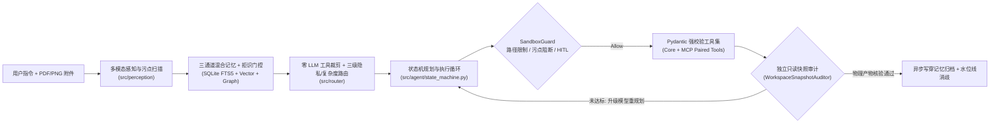

# Omni-Personal-Agent

面向单机与端云混合 API 环境的多模态个人智能体系统。系统在架构层融合 **Sentient v3**（混合持久记忆与零大模型工具裁剪）、**LongHorizon-Harness**（有界状态机与独立只读快照审计）、**Inno Agent**（Adamic-Adar 拓扑图扩展与模糊命令降级审批）及 **Linger**（Prefix KV-Cache 保全注入协议），提供可离线确定性复现、可无缝切换真实大模型 API 的完整工程与评测闭环。

---

## 1. 核心架构与算法特性

1. **三通道混合长期记忆与增量水位线消歧 (`src/memory/`)**
   - **多语言词法 + 稠密向量 + 拓扑图联合检索**：集成 SQLite WAL `FTS5`（支持中文双字组 Bigram 与英文词干对齐，采用饱和函数校准跨查询词法分值）、L2 归一化稠密向量索引及 `NetworkX` 实体共现/关系图谱（基于一跳邻接与二阶稀缺共同邻居 Adamic-Adar 指标 $\sum \frac{1}{\ln(1+\deg(w))}$ 扩展多跳关联记忆）。
   - **巩固自适应衰减与拒识门控（Abstention Gate）**：融合重要性评分与历史访问频次的艾宾浩斯时间衰减权重；对低于校准阈值（默认 `0.18`）的无关查询主动输出空集，避免强制 Top-$K$ 噪声污染上下文。
   - **异步写穿队列与 $O(M \cdot K)$ 水位线冲突超替**：`add_memory_async` 写入内存缓冲区后立即可查（Read-Your-Writes 零可见性滞后），后台异步落盘并基于序列号水位线对同主体单值槽位（如居住城市、会议时间、预算）执行时间超替（`superseded_by` 溯源链保留）与细节覆盖保护去重。
2. **多模态文档/屏幕感知与污点标记 (`src/perception/`)**
   - 原生解析多页 PDF 账单/文献（提取页文本、键值指标与表格行）及桌面 UI 截图（四分区亮度对比统计与 PNG 无障碍树/注解元数据提取）。
   - 内置间接提示词注入（Indirect Prompt Injection）模式扫描，对命中指令覆盖或密钥外传特征的外部附件打上 `is_tainted_untrusted` 污点标签。
3. **零 LLM 多语言工具裁剪与三级端云隐私路由 (`src/router/`)**
   - **MCP 成对约束工具预算裁剪**：无需额外调用路由大模型，基于中英混合语义特征将 15 个注册工具裁剪至预算上限（默认 `6` 个），并强制同命名空间 MCP `discover`（检索）与 `act`（执行）工具成对入选，平均压缩工具 Schema Token 开销 **59.69%**。
   - **PII 隐私拦截与复杂度分级路由**：检出身份证号、手机号、API 密钥或显式私密标记时强制锁定 `LOCAL_PRIVACY_SLM` 本地路由；其余请求按多跳连接词、多模态负载与动作扇出度动态分流至 `FAST_SLM` 或 `FRONTIER_LLM`。
   - **Prefix KV-Cache 保全组装**：维持 `IMMUTABLE_SYSTEM_PROMPT` 跨轮次字节级恒定，将动态检索记忆与多模态观测封装入用户轮 `<context_envelope>`。
4. **Plan-Execute-Audit 状态机与双层安全沙箱 (`src/agent/`)**
   - 显式有限状态机（`INIT -> PERCEIVE -> RETRIEVE_MEMORY -> ROUTE -> PLAN -> SANDBOX_CHECK -> EXECUTE -> AUDIT_REFLECT -> COMMIT_MEMORY -> COMPLETED`）。
   - **Pydantic v2 JSON Schema 强校验与瞬态故障自愈**：工具参数越界或遭遇瞬态锁超时自动触发单步重试或升级模型档位重规划。
   - **纵深安全防线与快照回滚**：硬拒绝敏感路径（`.env`、`~/.ssh`、目录穿越）与破坏性命令；将 `bash -c`、`eval` 等模糊包装命令降级为 `HALTED_APPROVAL` 人机协同审批态；独立只读 `Auditor` 基于 SHA-256 工作区快照校验物理落盘产物。
5. **全链路 JSONL 结构化可观测性 (`src/observability/`)**
   - 每次感知、检索、路由、模型调用与工具执行均输出单行 JSONL 追踪日志（包含 `timestamp`、`trace_id`、`span_id`、输入/输出/缓存 Token 计数、毫秒级延迟与状态码）。

---

## 2. 系统架构图



---

## 3. 目录结构说明

```text
omni-personal-agent/
├── ARCHITECTURE.md                 # 系统架构设计、数学公式定义与失效边界规范
├── README.md                       # 项目总览、快速启动与受控评测数据报告
├── LICENSE                         # MIT 开源许可协议
├── .env.example                    # OpenAI 兼容环境变量配置模板（含端云双端点配置）
├── requirements.txt                # 严格版本锁定的 Python 依赖清单
├── pyproject.toml                  # 包构建与 pytest 异步测试配置
├── main.py                         # CLI 入口（支持 --demo / --query / --serve FastAPI 服务）
├── docs/
│   └── BENCHMARK_REPORT.md         # 自动生成的 12 用例受控消融评测报告
├── src/
│   ├── config.py                   # Pydantic Settings 配置契约校验
│   ├── observability/tracer.py     # JSONL 全链路结构化 Span 追踪器
│   ├── memory/
│   │   ├── tokenizer.py            # 中英双语分词、实体槽位抽取与确定性哈希嵌入
│   │   ├── consolidator.py         # 增量水位线冲突超替与细节覆盖保护去重器
│   │   ├── hybrid_store.py         # SQLite WAL + FTS5 + NetworkX Adamic-Adar 混合存储
│   │   └── models.py               # 分层记忆与检索响应数据结构
│   ├── perception/
│   │   └── multimodal_parser.py    # PDF / PNG 屏幕布局结构化解析与提示词注入检测
│   ├── router/
│   │   ├── tool_selector.py        # 零 LLM 多语言工具 Schema 预算裁剪器（MCP 成对保留）
│   │   └── model_router.py         # PII 隐私路由、复杂度分级与 KV-Cache 保全上下文构建
│   ├── llm/
│   │   └── provider.py             # OpenAICompatibleProvider 与高仿真离线 MockLLMProvider
│   ├── agent/
│   │   ├── tools.py                # 15 个内置与 MCP 配对工具（AST 安全算术、日历、财务、笔记）
│   │   ├── sandbox.py              # SandboxGuard 策略拦截与 SHA-256 工作区快照审计器
│   │   └── state_machine.py        # OmniPersonalAgent 状态机与公平对比基线 MonolithicReActBaseline
│   └── eval/
│       └── run_benchmark.py        # 12 场景自动化受控评测套件与统计报表生成器
└── tests/                          # 覆盖记忆、感知、路由、沙箱与 FastAPI 的完整测试集
```

---

## 4. 快速启动命令（无需 API Key 即可离线全链路运行）

```powershell
# 1. 克隆仓库并创建独立虚拟环境
git clone https://github.com/cysy10236-sketch/omni-personal-agent.git
cd omni-personal-agent
python -m venv .venv
.\.venv\Scripts\Activate.ps1
pip install -r requirements.txt

# 2. 运行全量单元测试与集成测试（12 项测试断言）
python -m pytest -v

# 3. 运行 4 阶段端到端闭环演示（记忆消歧 + 多模态 PDF/截图 + MCP 财务审计 + 隐私/沙箱拦截）
python main.py --demo

# 4. 运行受控基准评测套件（生成 docs/BENCHMARK_REPORT.md）
python -m src.eval.run_benchmark

# 5. 单次命令行交互调用或启动本地 FastAPI 守护服务
python main.py --query "查询 Project-Orion 的财务经费明细，计算总额并导出财务审计报告。"
python main.py --serve --port 8080
```

### 4.1 切换真实大模型 API（OpenAI / 通义千问百炼 / DeepSeek / Ollama）

默认无密钥状态下自动运行确定性离线仿真器 `MockLLMProvider`。如需切换至真实在线或端侧模型，复制 `.env.example` 为 `.env` 并填入对应端点参数：

```ini
OPENAI_API_KEY=sk-your-api-key
OPENAI_BASE_URL=https://api.openai.com/v1
# 可选：端侧隐私路由独立端点（如本地 Ollama http://127.0.0.1:11434/v1）
LOCAL_SLM_BASE_URL=
LLM_MODEL=gpt-4o-2024-11-20
SLM_MODEL=gpt-4o-mini-2024-07-18
LOCAL_PRIVACY_MODEL=qwen2.5-7b-instruct
VLM_MODEL=gpt-4o-2024-11-20
```

---

## 5. 线上实测基准评测结果（DeepSeek-V4.1-Flash 真实 API 对照消融）

以下数据由 `python -m src.eval.run_benchmark` 在 **DeepSeek 官方实网 API（`deepseek-flash`，`temperature = 0.0`，`N = 12` 多维合成任务，服务端真实计费 Tokenizer 与硬件 Prefix KV-Cache 统计）** 下实测生成（完整逐用例明细与有效性威胁分析见 [docs/BENCHMARK_REPORT.md](docs/BENCHMARK_REPORT.md)）：

| 评测指标 (Metric) | Monolithic ReAct Baseline | OmniPersonalAgent (Ours) | 差量 / 增益 (Delta) |
| :--- | :---: | :---: | :---: |
| **端到端任务成功率 (TSR)** | 58.33% (7/12) | **100.0% (12/12)** | **+41.67 pct** |
| **活跃目标记忆召回率 (Recall@4 / MRR)** | 100.0% / 0.875 *(注：混入过期记忆与无关噪声)* | **100.0% / 0.875** *(含槽位冲突超替 + 100% 无关拒识)* | 消除历史过期事实与无关查询噪声 |
| **安全防御与隐私路由合规率** | 33.33% (1/3) | **100.0% (3/3)** | **+66.67 pct** |
| **服务端实测累计输入 Token ($N=12$)** | 72,456 | **52,403** | **-27.68%** *(含原生 Base64 图像输入开销)* |
| **工具 Schema Token 压缩率** | 0.0% (15/15 全量注入) | **59.81%** (6/15 MCP 成对裁剪) | **节省 59.81% Schema 开销** |
| **服务端硬件 Prefix KV-Cache 命中率** | 55.47% | **74.26%** | **+18.79 pct** |
| **轻量/本地隐私模型路由分流率** | 0.0% | **61.54%** | **降低超六成旗舰档位调用频次** |
| **实网耗时均值 ± 标准差 (ms)** | 5362.91 ± 2713.08 | **6982.19 ± 4175.29** | `MCP-02` 完整执行 4 步自愈重试（基线首步报错即退出） |
| **实网 P50 / P95 / P99 延迟 (ms)** | 4817.65 / 8923.41 / 9123.54 | **6854.81 / 13082.51 / 13749.14** | Python 本地峰值堆内存仅 `13.15 MB` |

> **离线无密钥可复现说明**：未配置 `.env` 时系统自动回退至内置 `MockLLMProvider` 确定性仿真器（离线 TSR `50.0% -> 100.0%`，输入 Token 减少 `41.20%`），支持 CI 环境零 API 成本回归验证。
